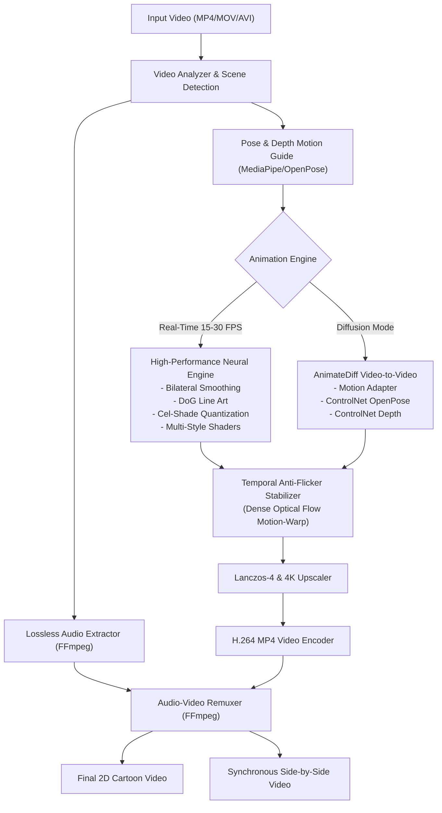

# AI 2D Cartoon Video Studio

An AI-powered video transformation studio built with **Streamlit**, **PyTorch**, **Hugging Face Diffusers**, **AnimateDiff Video-to-Video**, **ControlNet**, **OpenCV**, **MediaPipe**, and **FFmpeg**.

Transforms real-life videos into consistent 2D cartoon animations while preserving body movements, gestures, facial expressions, camera composition, and audio synchronization.

---

## ✨ Core Features

1. **2D Cartoon Character Transformation**: Converts real people into stylized 2D cartoon characters.
2. **Environment & Background Stylization**: Cartoonizes background scenery, lighting, and ambient textures.
3. **Motion & Gesture Preservation**: Retains body poses, hand movements, and actions via OpenPose skeleton tracking.
4. **Facial Expression & Camera Consistency**: Preserves facial geometry, gaze, and original cinematography.
5. **Temporal Anti-Flicker Stabilization**: Eliminates cross-frame jitter with dense optical flow motion compensation (`cv2.calcOpticalFlowFarneback`) and scene-cut boundary resets.
6. **5 Distinct 2D Cartoon Styles**:
   - **Classic 2D Cartoon**: Bold clean ink lines, warm vibrant cel-shading, flat palette.
   - **Anime (Japanese Animation)**: Makoto Shinkai aesthetic, luminous skies, delicate lines, bloom.
   - **Comic-Book Animation**: Heavy graphic novel inking, deep black shadows, pop art contrast.
   - **Hand-Drawn Animation**: Graphite/charcoal pencil contours, soft watercolor wash, paper grain.
   - **Colorful Animated Movie**: Disney/Pixar 2D storybook style with soft specular highlights.
7. **Lossless Audio Preservation**: Seamless FFmpeg extraction and synchronized frame-accurate remuxing.
8. **Multi-Resolution & 4K Output**: Supports original resolution, 720p HD, 1080p Full HD, and 4K Ultra HD upscaling.
9. **Synchronous Single-Frame Comparison Player**: Side-by-side single-player comparison view (`hstack`) clearly displaying both Original and 2D Cartoon in one frame.

---

## 🛠️ System Architecture



---

## 💻 Windows Installation Guide

### Prerequisites
- Windows 10/11 (64-bit)
- Python 3.10+ (Python 3.11/3.12/3.14 compatible)
- FFmpeg installed and added to Windows PATH (`ffmpeg -version`)

### Step 1: Clone or Navigate to Directory
```powershell
cd d:\F\mine\face-swap\cartoon_studio
```

### Step 2: Create and Activate Virtual Environment
```powershell
python -m venv venv
.\venv\Scripts\activate
```

### Step 3: Install Dependencies
```powershell
pip install -r requirements.txt
```

### Step 4: Run the Streamlit Dashboard
```powershell
streamlit run app.py
```

Open your browser at `http://localhost:8501`.

---

## 🧪 Automated Testing
Run the automated test suite using pytest:
```powershell
python -m pytest tests/ -v
```

